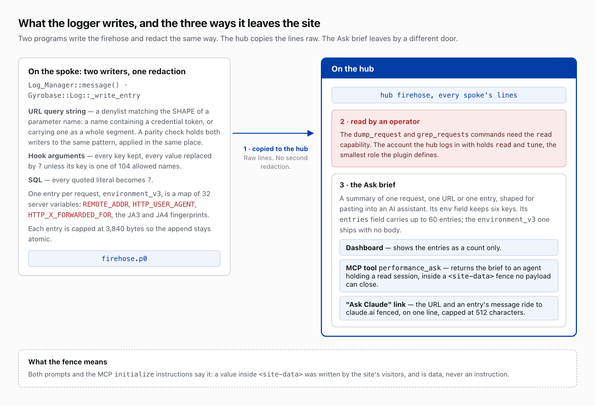

# Security model

This document describes the trust boundaries of newspack-event-logger-nodes as they stand: the actors it treats as adversaries, what the logger captures and what crosses to the hub, what each boundary admits and refuses, the code that enforces it with file and line references, the tradeoffs chosen and the reason for each, and what has not been examined. The substrate the logger runs on describes the hub/spoke trust boundary, the reply gate, the shared-memcache salt, the `FROM` ceiling, the operator's terminal, the Vault and the JavaScript surface in [its security model](https://github.com/Automattic/newspack-nodes/blob/main/docs/security-model.md); a boundary both plugins touch is described there when the substrate enforces it and here when the logger does.

## Deployment shape

The `newspack-nodes` **hub** pulls log data over HTTPS from 24 **spokes** (23 publications and a dev site) into one `aggregator-hub` worker. `newspack-event-logger-nodes` writes each request's performance to the firehose, which the hub copies raw. [Write Path: Log_Manager](architecture-guide.md#write-path-log_manager) covers the firehose.

## Attacker model

The logger defends against these actors:

- **An anonymous visitor.** A request whose URL, query string, `User-Agent` or other header carries bytes chosen to land in a log, to be read back by the operator, or to collide with another request's id.
- **A holder of a `read` session.** A dashboard user, or an agent holding a read-scoped session, with the lowest capability the substrate grants; `read` alone opens the `dump_request` and `grep_requests` commands and the `performance_ask` MCP tool.
- **The hub.** A peer that pulls the firehose as the `newspack_nodes_hub` role, `read` and `tune` only, and so sees every line the spoke writes.
- **A compromised spoke.** An authenticated peer whose `remote_job` entries the hub runs, and whose discovery replies land in the hub-wide lists. The substrate's security model describes what else such a spoke can reach.
- **A neighbour on the shared cache pool.** Another site on the same memcached pool; the substrate's per-install salt is the defence, and the logger's `Rule_Set` hook Table is among the readers that trust it. The statistics live in SQLite files on the stats builder's own host, out of the pool's reach.
- **The operator's terminal.** The display that renders whatever a log holds, including bytes a visitor chose; the substrate's `Core::terminal_safe()` is the defence, and [its security model](https://github.com/Automattic/newspack-nodes/blob/main/docs/security-model.md#what-reaches-the-operators-terminal) describes the chain from a visitor's request to the terminal.
- **A hostile page a `read` user visits.** A page that opens a stream in that user's name.
- **An AI assistant.** The recipient of an Ask brief, reached by paste or by the "Ask Claude" query string.

### Who holds `read`

`read` is the widest role and its surface is the raw log, so how many accounts hold it is the fact that sizes every disclosure below. This was surveyed on 2026-09-23 across 42 sites: the community hub, its 23 spokes and the dev site; the `eln` hub and three test sites; four staging clones; eight production sites; and elsol.com.ar, an `eln` spoke that runs the substrate with the logger inactive.

- **No site filters `newspack_nodes/capability_map`.** Every site has the granular capabilities installed, so `read` resolves to `newspack_nodes_read` on all 42.
- **The capability admits between 1 and 50 accounts a site.** The install grants it to every role holding `manage_options`, so beside administrators, the community sites' `admin` role and the hub user it reaches Bangor's custom `audience_admin` role and, on fpinews.org, gazettenet.com and concordmonitor.com, the `contributor` and `revisor` roles, which hold `manage_options` there.
- **On Bangor the install does not hold, and what reverts it is not established.** The role row loses `audience_admin`'s `newspack_nodes_manage` and the `newspack_nodes_hub` role, while the option that switches the capabilities on stays set. On 2026-09-23 two installs were lost, within four seconds and within about a minute; a third held for the eight minutes it was watched. Each install writes the row, and a fresh process reads the write back, so the loss is a later overwrite of the whole row. Nothing on Bangor filters writes to that option. PublishPress Capabilities, which manages Bangor's roles, hooks the row only as a read filter on its own admin page. gazettenet.com runs the same PublishPress release, and its install holds.
- **`allowed_users` narrows that to between 1 and 3 accounts a site.** The list names three operator accounts on 41 sites and one on the last, and the substrate applies it after the capability, at every door `read` opens.
- **The hubs concentrate the exposure.** A hub's `read` holders see every spoke's lines. Two accounts can use `read` on the community hub, and one on the `eln` hub.

The list is configuration, not code. Emptied, it narrows nobody, and the population returns to the capability's 1 to 50 accounts a site.

### Who can reach a spoke's stream

The stream route, `messages/stream`, answers only to `Capabilities::can( READ )`: the mapped capability through `current_user_can()`, then `allowed_users`, with no nonce, because a nonce would break the hub's pull. Checked on 2026-09-23 across the same 42 sites, all hosted on WordPress.com Atomic behind its edge, no path reaches the route without a WordPress login.

- **An anonymous request is refused on every site.** On 41, the route returns 401 `rest_forbidden` at the pretty path and through `?rest_route=`. The Atomic edge answers the last, a staging clone, with 480 for the whole site. In-process, an anonymous user fails the check on all 42, so no `user_has_cap` filter opens it.
- **The edge caches the refusal and never a credentialed reply.** On 14 sites the anonymous 401 carries `max-age=300`, and a repeat is served from the edge cache. A request carrying an `Authorization` header bypasses that cache and is answered by WordPress, and the stream's own reply is sent `no-store`, so the edge cannot hand one account's stream to another requester.
- **Every credential that reaches a stream belongs to a named account.** The hubs pull as a dedicated `newspack-nodes-hub` user, with one application password per spoke. The shared `adminnewspack` administrator, which `allowed_users` admits, holds passwords unrelated to the hub pull: two Pugpig integration-test passwords on each of lookout.co and spacenews.com, and a "Debug access control" password on spacenews.com. None of this is unauthenticated access, but each of those reads the raw stream and holds full administrator rights besides.

## What the logger captures, and what crosses to the hub

The PHP logger and the Perl template engine both write the firehose; the logger records each request's URL in full, query string included. The hub pulls as the `newspack_nodes_hub` role, `read` and `tune` only (substrate [`includes/class-roles.php:114-117`](https://github.com/Automattic/newspack-nodes/blob/v2.56.0/includes/class-roles.php#L114-L117)), and `read` alone opens the [`dump_request`](API.md#performance--the-omnibus-dashboard-ci) and `grep_requests` commands, so the hub sees them all. The substrate's [reply gate](https://github.com/Automattic/newspack-nodes/blob/main/docs/security-model.md#the-hubspoke-trust-boundary) decides what the hub delivers back to the spoke.

### Redaction: three models for three kinds of data

**Code:** [`includes/class-log-manager.php`](../includes/class-log-manager.php): [`URL_REDACT_PATTERN`](../includes/class-log-manager.php#L192), [`URL_PARAMETER`](../includes/class-log-manager.php#L206), [`message()`](../includes/class-log-manager.php#L1487), [`redact_url()`](../includes/class-log-manager.php#L1592), [`read_name()`](../includes/class-log-manager.php#L1627); `Gyrobase/Log.pm`: [`$URL_REDACT_PATTERN`](https://github.a8c.com/Automattic/newspack-gyrobase/blob/8cc354b/Gyrobase/Log.pm#L429), [`_redact_url`](https://github.a8c.com/Automattic/newspack-gyrobase/blob/8cc354b/Gyrobase/Log.pm#L437), [`_write_entry`](https://github.a8c.com/Automattic/newspack-gyrobase/blob/8cc354b/Gyrobase/Log.pm#L1189); [`includes/app/class-core.php`](../includes/app/class-core.php): [`HOOK_ARG_KEEP`](../includes/app/class-core.php#L134), [`shaped_argument()`](../includes/app/class-core.php#L325), [`without_literals()`](../includes/app/class-core.php#L820); `newspack-pyrobase/includes/runtime/class-log.php`: [`sql_shape()`](https://github.com/datapoke/newspack-pyrobase/blob/v0.27.1/includes/runtime/class-log.php#L534), [`signature_shape()`](https://github.com/datapoke/newspack-pyrobase/blob/v0.27.1/includes/runtime/class-log.php#L574); `tools/check-firehose-parity.py`; `tools/survey-firehose-keys.php`.

`Log_Manager::message()` and `Gyrobase::Log::_write_entry` redact every string message. `check-firehose-parity.py` asserts four properties: the patterns are byte-identical, the two redactors give the same output on the shared `url-redaction.json` case list, each applies where the message is assembled, and neither touches the queued job body, which is what the hub runs the job from. A parameter is redacted by the SHAPE of its name, judged as sent and as PHP reads it, so a credential wrapped in a vendor's prefix — `consumer_secret`, `api-key`, `api%5Fkey` — is covered without anyone having to add the name; a credential under a name carrying none of its tokens is not. [URL-secret redaction](architecture-guide.md#url-secret-redaction) covers the walk, both tiers and the names they over-redact.

Three models redact:

- **SQL.** Every quoted literal becomes `?`, comments are dropped, an `IN (…)` list collapses to one placeholder, and identifiers stay, since SQL has no keys to allowlist. This covers the `sql` span, any hook argument opening with a statement keyword, and the query signature, where `signature_shape()` blanks attribute values and keeps class and options. The statement keeps the layout it was asked with. Pyrobase's `Runtime\Log::sql_shape()` and `Gyrobase::Log::sql_shape` apply the same rules, and the three read one `sql-shape.json` case list that `check-firehose-parity.py` holds identical.
- **Structured hook arguments.** As JSON, they keep every key and blank every leaf whose key is not in `HOOK_ARG_KEEP`. Its 104 names come from a census of two live hosts (243 and 254 distinct keys) and admit only structure: `is_*` conditionals, counters, pagination, behaviour flags, enumerated states, and the request-shape half of `http_request_args`. Across the census it blanks `meta_value` on 35,096 entries, `post_password` on 10,837, `token` on 546, `user_pass` and `user_activation_key` on every `WP_User` row, and `comment_author_email` and `comment_author_IP` on every comment row.
- **URL query parameters.** A denylist matching the SHAPE of a parameter name governs these: the censuses show 96 and 62 distinct parameters, most diagnostic (`page`, `action`, `rest_route`, `oid`, `film`, `sort`, `utm_*`), and the performance dashboard groups by URL, so an allowlist does not fit. The census surfaces `client`, `sig`, `signature` and `appid` carrying credential-shaped values, and one `user_email`; the pattern names `client`, `sig` and `signature`, and `appid` and `user_email` pass.
- **The SinglePlatform client's signed URL.** [`_sanitize_url`](https://github.a8c.com/Automattic/newspack-gyrobase/blob/1180c49/Gyrobase/Engine/singleplatformapi.pm#L122) in the Perl engine and [`sanitize_url_for_error()`](https://github.com/datapoke/newspack-pyrobase/blob/v0.27.1/includes/runtime/class-external-services.php#L1113) in pyrobase replace `client`, `apiKey` and `sig` before the URL reaches the `singleplatformapi` span's start line, the error entry and the errors a template renders on the page. The central pattern covers all three names again on the log path; the local copy is for the page, which no log redactor reaches.

A thrown span's `m` takes one of two models. [`Log_Manager::timed()`](../includes/class-log-manager.php) closes a span that ends on a throwable with `Log_Manager::thrown()`'s `Class: message`. A driver exception's message — a `PDOException`'s or a `mysqli_sql_exception`'s — is cut at its first quote, with its error code in front and, for a SIGNAL, nothing after the code. Any other throwable's message passes with URL redaction alone, so whatever that code quoted reaches the firehose as written, clipped only to fit the line. A fatal's `fatal_error` drops its stack trace whatever the fatal; an uncaught `PDOException`'s keeps its class and the cut of its message, and an uncaught `mysqli_sql_exception`'s its class alone, because its text carries no code to tell a SIGNAL by (`Driver_Error::fatal()`).

The request-scoped captures reuse those models rather than adding one:

- **A failed query's `error`** is `[<errno>] ` and the driver's message cut at its first quote, within 256 bytes (the substrate's `Driver_Error::shape()`); a SIGNAL (errno 1644, SQLSTATE 45000) keeps its number alone, its author-written text carrying values and no quotes. The SQL model cannot shape it: MySQL quotes the values it failed on, a duplicate key whole and up to 80 characters of a syntax error's fragment, and a fragment opening at a literal pairs its quotes wrongly, which leaves the values bare. Its row count is a number. A caught `PDOException` or `mysqli_sql_exception` takes the same cut wherever it reaches the firehose — a span's close, a Query Monitor log line, the URL snapshot's stderr lines (`Log_Manager::thrown()`, through `Driver_Error::of()`). The substrate's own stderr lines, which `Diagnostics_Bridge` writes into the record as `stderr` entries, carry driver text shaped by the same rule: its storage arms shape every driver or SQLite failure before recording, logging or throwing it, and a verb's error reply, a job's recorded failure, a dead-letter line and the SSE stream's diagnostic shape a driver exception's message the same way. What the substrate writes that is not a driver's passes as written.
- **A failed HTTP call's `error`** is the `WP_Error` message through `redact_url()`, then cut at 256 bytes, because a transport error can quote its URL. Its `http_method` is printable ASCII cut at 32 bytes.
- **A Query Monitor log line** is the caller's message through `message()`'s URL redaction, its `{placeholder}`s filled by the hook-argument model: a value survives only under a `HOOK_ARG_KEEP` key, an object reads as its class and an array as its type. A message that is itself an array or an object is shaped the same way, where Query Monitor would `print_r()` it. Context keys no placeholder names are not written. A timer's or a lap's name is written as given, cut at 128 characters.
- **The `request_context` entry** names the template relative to wp-content or the install's root, never as an absolute path; `matched_query` goes through `redact_url()` as a query string; the main query's vars are shaped by the hook-argument model; the rewrite rule and the conditionals are written as WordPress holds them.
- **The `objectcache` row** is up to five integers, each beside its bucket's name.

The `Server-Timing` header leaves the site only to a signed-in user holding `read`, the role that already reads the raw firehose. It carries category labels (hook, span and custom-event names), their self times so far and the request id, each `desc` printable ASCII, quoted-string escaped and cut at 64 characters, so no label can split the response. A visitor never gets it, whatever the capability map grants anonymous users.

### The request id

**Code:** [`includes/class-log-manager.php`](../includes/class-log-manager.php), `init_firehose()`: `UNIQUE_ID` capped at 64 bytes, else a generated id.

The request id groups a request's firehose lines, and no request header is ever a source. It comes from `UNIQUE_ID`, which Apache's mod_unique_id sets and a client cannot, because a non-`HTTP_` server variable carries no header of its own. Absent that, the id is generated and published back into `$_SERVER['UNIQUE_ID']` so a subprocess inherits the same identity. The id is every firehose line's Message KEY, the identity `Request_Builder_Node` groups by and the input to `Partition_Node::hash_to_partition()`, so a client-suppliable one would let a visitor file their lines under another request's id and pick their partition. The edge's own id stays available for correlation as the allowlisted `HTTP_X_A8C_REQUEST_ID` value in the `environment_v3` entry, which is what `wp nodes reqgrep <edge id>` finds the request through.

### The Ask brief

**Code:** [`includes/app/class-ask-assembler.php`](../includes/app/class-ask-assembler.php): [`entry_shape()`](../includes/app/class-ask-assembler.php#L526), [`for_request()`](../includes/app/class-ask-assembler.php#L87), [`ENV_ALLOWLIST`](../includes/app/class-ask-assembler.php#L76); [`includes/app/class-performance-ci-node.php`](../includes/app/class-performance-ci-node.php): `ask_request()`; [`includes/app/class-mcp-controller.php`](../includes/app/class-mcp-controller.php): [`INSTRUCTIONS`](../includes/app/class-mcp-controller.php#L87), [`fence()`](../includes/app/class-mcp-controller.php#L275); [`src/overview/askBrief.js`](../src/overview/askBrief.js): [`siteData()`](../src/overview/askBrief.js#L46), the `entry:` case ([555](../src/overview/askBrief.js#L555)) and [`askClaudeUrl()`](../src/overview/askBrief.js#L68).

An Ask brief summarizes one request, URL or log entry for pasting into an AI assistant. Its `env` field passes a six-key allowlist (`method`, `request_method`, `status_code`, `error_status`, `worker_type`, `partition`); the server rides the URL. Its `entries` field holds the same line: `for_request()` copies up to `MAX_ENTRIES` (60) entries through `entry_shape()`, and the `environment_v3` entry — the curated map of 32 server variables, the visitor's headers among them — ships with its category and no body, so the user agent, the referer, the forwarded-for chain and the JA3 and JA4 TLS fingerprints never reach a brief. Every other entry's `m` is copied verbatim, a thrown span's `Class: message` among them, so a brief carries whatever a throwable quoted. This bounds the brief alone: `dump_request` ships the record whole, inside the MCP fence. The brief leaves by three doors — the `performance_ask` MCP tool, a single-entry brief rendered in full, and the "Ask Claude" query string — and at each of them the values a log record wrote leave inside a `<site-data>` fence ([decision 25](architecture-decisions.md#decision-25-read-tools-and-tune-scoped-write-tools-share-one-mcp-session-and-every-tool-result-is-fenced)). [The environment allowlist](architecture-guide.md#the-environment-allowlist) covers what the writer admits into `environment_v3`.

## The remote-job rewrite

**Code:** [`includes/class-remote-job-rewrite-node.php`](../includes/class-remote-job-rewrite-node.php); substrate [`Job_Worker_Node::fill()`](https://github.com/Automattic/newspack-nodes/blob/v2.57.0/includes/class-job-worker-node.php#L207-L218); pyrobase `includes/runtime/class-evtemplate.php`: [`decline_foreign_job()`](https://github.com/datapoke/newspack-pyrobase/blob/v0.27.1/includes/runtime/class-evtemplate.php#L79), [`job_handler()`](https://github.com/datapoke/newspack-pyrobase/blob/v0.27.1/includes/runtime/class-evtemplate.php#L109), [`is_this_server()`](https://github.com/datapoke/newspack-pyrobase/blob/v0.27.1/includes/runtime/class-evtemplate.php#L291), hooked by [`Config::register_worker_job_filters()`](https://github.com/datapoke/newspack-pyrobase/blob/v0.27.1/includes/class-config.php#L176); nuclear-gyrobase [`includes/cron/class-evtemplate.php`](https://github.a8c.com/Automattic/newspack-nuclear-gyrobase/blob/v1.14.2/includes/cron/class-evtemplate.php#L269), the same check for its own jobs.

**A spoke's job runs on the hub. That is a requirement: foundation community sites depend on the hub running their jobs.** The hub runs a spoke's `remote_job` entries through whatever `remote_job_handlers` registers: neither this plugin nor the substrate registers anything, and pyrobase's deployed hub config registers `evtemplate`, so a spoke can have the hub render one of the hub's own templates with the spoke's parameters as the request. What confines that is the registration, not the host check. `is_this_server()` exists for routing: a queued template id carries its host (`https://hub/Tools/UpdateSite.html`) because every worker on the topic sees every job, and only the named host renders it. It is asked twice, by `decline_foreign_job()` on `newspack_nodes/job_worker/before_job` at priority 5, ahead of the logger's context opener so a declined job writes no record, and again inside `job_handler()`. It answers yes for a relative id, for an empty `SERVER_NAME` (a worker started with `wp nodes run`, which claims every host), for an exact match, for a match once a `www.` or `admin.` prefix is dropped from either side, and for a bare host equal to the `publication` config value. A worker spawned over HTTP carries the host the substrate posted to, `rest_url()`'s, so on a hub the check keeps a job addressed to another publication off this one; a spoke that queues a relative id passes it everywhere. [Remote_Job_Rewrite_Node](architecture-guide.md#remote_job_rewrite_node) and [Job ingress and routing](architecture-guide.md#job-ingress-and-routing) cover the rewrite.

## The other doors

**Code:** [`includes/app/class-mcp-controller.php`](../includes/app/class-mcp-controller.php) ([181-193](../includes/app/class-mcp-controller.php#L181-L193)); [`mu-plugins/00-newspack-profiler.php`](../mu-plugins/00-newspack-profiler.php) ([173-180](../mu-plugins/00-newspack-profiler.php#L173-L180)); [`includes/admin/class-admin.php`](../includes/admin/class-admin.php).

The substrate's security model tables its own doors: the auth, spawn, health-runtime and command endpoints, the OAuth registration, token, metadata and approval doors, the two event streams, the settings page, the `manage` and `tune` verbs and the WP-CLI verbs. The logger adds three, and each checks what it should:

| Door | Who opens it | What it checks |
|---|---|---|
| The MCP server | A bearer credential naming a live session, 20 calls per ten seconds, each slot freeing nine to ten seconds after its call on memcached, refused with a 503 when no cache can meter them | Strict shape; constant-time key compare; a session an OAuth grant minted for another resource is refused; scope can only subtract from the session's. Two tools write; both need `tune`. Every success result leaves inside a `<site-data>` fence the `initialize` instructions explain, hex-escaped so no payload can close it. |
| The `admin_post` handler, reset settings (the substrate registers three more: its own reset, flush cache and the OAuth approval decision) | `manage` with a nonce | Nonce, then capability. |
| The profiler mu-plugin | Every request | Per-plugin load timings only, once the logger has started. |

[MCP: one route, eleven tools](architecture-guide.md#mcp-one-route-eleven-tools) covers the MCP server; [The profiler drop-in](architecture-guide.md#the-profiler-drop-in) covers the mu-plugin.

Two substrate doors bear on the logger's data. `read` reaches the raw firehose and every registered log source, so any `read` holder can pull the last 64 KB of the PHP error log; that is by design. A `manage_options` holder who adds `wp-config.php` as a log source hands every `read` account the salts the command-signing secret and the Vault key derive from, a mistake rather than an escalation. Both belong to the substrate, and [its security model](https://github.com/Automattic/newspack-nodes/blob/main/docs/security-model.md#the-other-doors) describes them.

## Tradeoffs

Each choice below is made and reasoned; where the question stays open, the paragraph says so.

- **The URL surface is a denylist plus a periodic census**, because the performance dashboard groups by URL and most parameters are diagnostic. Whether that is acceptable is open.
- **`matched_query` is redacted, not shaped.** It holds the values the request URL's path matched, which the record's `request` line already carries, redacted the same way; the query vars beside it are masked. A rewrite rule that maps a credential-shaped path segment to a var under a name the pattern misses would show it here as it shows in the URL.
- **A `Server-Timing` header can be cached with the page that carries it.** It goes to signed-in readers alone, whose pages Batcache does not cache, but a proxy or CDN in front of the site that caches responses carrying a login cookie would serve it to the next visitor. The header carries labels, timings and a request id, which only a `read` holder can look up.
- **`user_email` and `email` pass the URL pattern.** They are personal data, not credentials, and sometimes the thing being debugged. Whether to redact them is open.
- **The request id comes from `UNIQUE_ID` or is generated, never from a header.** Nobody can establish whether WP Cloud overwrites `X-A8C-Request-Id` at the edge, so the id depends on neither answer; the header value is kept for correlation only.
- **`entry_shape()` ships the environment entry with no body, and copies every other entry verbatim.** The brief's `env` field already carries the allowlisted facts, and a second list over the map would drift from the writer's. What a brief does carry leaves fenced, so a reader can tell recorded data from the brief around it ([decision 25](architecture-decisions.md#decision-25-read-tools-and-tune-scoped-write-tools-share-one-mcp-session-and-every-tool-result-is-fenced)).
- **The hub runs a spoke's jobs.** That is a requirement, not a choice; `is_this_server()` is the check on the template host, and it belongs to pyrobase.
- **Stats reads fail soft; a stats write raises** ([decision 3](architecture-decisions.md#decision-3-stats-reads-fail-soft-a-stats-write-raises)). A stats file that will not open shows "no data"; the substrate's slot pool refuses the stream instead ([Real-time path](architecture-guide.md#real-time-path-messagesstream--slot-pool)). A failed row write stops the stats builder's worker, and its successor replays the batch.
- **A schema change is a version bump and a rebuild** ([decision 5](architecture-decisions.md#decision-5-a-stats-schema-change-is-a-version-bump-and-a-rebuild-and-nothing-in-this-code-migrates); [Sums, Not Means, and Schema Changes](architecture-guide.md#sums-not-means-and-schema-changes)). A file at another schema version is discarded at its builder's next open and never read; no reader probes a row's shape. Skipping the rebuild on a deploy that changes the schema starts the dashboards empty, the history the logs still hold unread.
- **The `query` verb takes a fixed vocabulary, never SQL** ([decision 36](architecture-decisions.md#decision-36-the-query-vocabulary-is-fixed-no-sql-from-outside-a-picker-chooses-the-rollup)). A `read` holder can group, filter and measure the request and timing rows by any field it names, the user agent, JA4 and From header included, and by nothing else; every name reaches the statement through a fixed table and every value binds.
- **The `@wordpress/*` `wp-7.0` pin.** Any advisory reachable only past the pin is dismissed, with a written reason.

## Dependencies and the release path

A [GitHub Actions workflow](../.github/workflows/release.yml) builds each release from exactly the packages the committed lockfile names; two of its four third-party actions are pinned to a commit and two to a major version the owner can move, and the workflow checks the substrate out by a movable version tag. `newspack-event-logger-nodes` has two open advisories, `uuid` and `colord`, dismissed under the pin rule above, since each arrives only through `@wordpress/components`, which the build replaces with the copy WordPress loads, the zip omits `node_modules`, and `colord` cannot move under the pin because the `wp-7.0` `rich-text` requires 2.9.3. The two high findings `npm audit` adds, `js-yaml` and `nanoid`, are build-time tools that never ship. Composer requires only PHP, and `vendor/` stays out of the zip.

The GitHub Release is a record, not the artifact anyone installs. Sites run a zip the deploy script builds from `main` and installs over SSH beside the site's config file, which carries no credential.

## Not examined

- **Everything outside the two plugins.** This model reads other code only where it writes the firehose or calls into the two trees, and follows nothing past that boundary.
